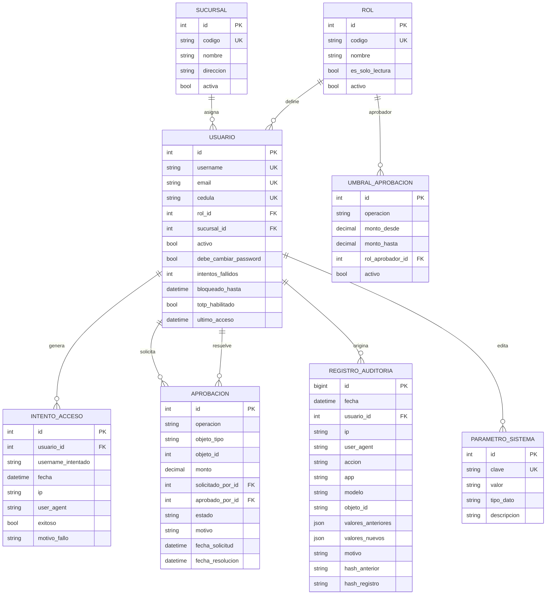
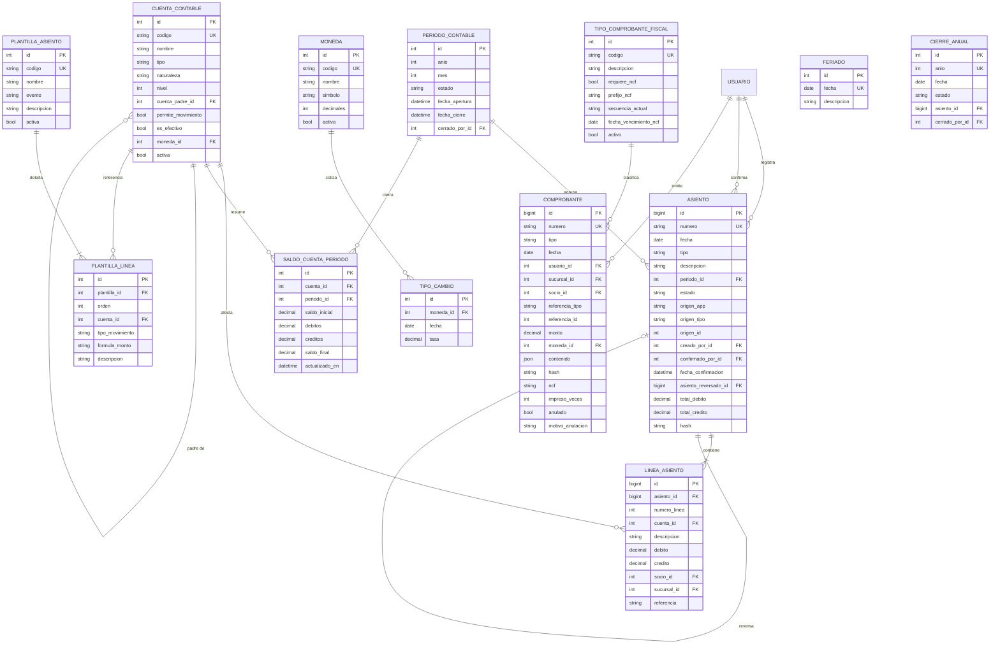
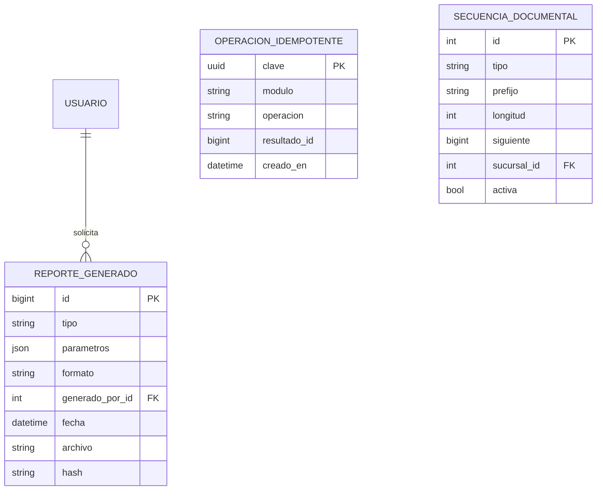

# COOPGESTION — Modelo de datos y diagrama entidad-relación

| Campo | Valor |
|---|---|
| Documento | Esquema de base de datos: entidades, relaciones e invariantes |
| Versión | 1.0 |
| Fase | 0.2 |
| Motor | PostgreSQL 16 |
| Estado | Propuesta para aprobación |

---

## 1. Convenciones

1. Nombres de tabla en `snake_case` singular; claves foráneas `<entidad>_id`.
2. Toda tabla financiera tiene `creado_en`, `creado_por_id` y, cuando aplica, `confirmado_en`/`confirmado_por_id`.
3. Montos: `NUMERIC(18,2)`. Tasas y porcentajes: `NUMERIC(9,6)`.
4. Fechas de negocio separadas de fechas de sistema:
   `fecha_valor` / `fecha_pago` (negocio) vs. `fecha_registro` / `creado_en` (sistema).
5. En tablas financieras **no se usa `on_delete=CASCADE`**: solo `PROTECT` o `RESTRICT`.
6. Los **saldos almacenados son cachés reconstruibles** desde los hechos. Existen por rendimiento y
   se verifican contra los asientos con el comando `verificar_cuadre`.
7. Estados como `TextChoices` con `db_index`, nunca como texto libre.

---

## 2. Diagramas entidad-relación

### 2.1 Seguridad, usuarios y auditoría



### 2.2 Contabilidad y documentos



### 2.3 Socios, ahorros y caja

```mermaid
erDiagram
    SOCIO ||--o{ BENEFICIARIO : "designa"
    SOCIO ||--o{ REFERENCIA_PERSONAL : "presenta"
    SOCIO ||--o{ DOCUMENTO_SOCIO : "aporta"
    SOCIO ||--o{ VERIFICACION_LISTA : "es verificado"
    SOCIO ||--o{ APORTACION : "realiza"
    SOCIO ||--o{ CERTIFICADO_APORTACION : "posee"
    SOCIO ||--o{ CUENTA_AHORRO : "titulariza"
    PRODUCTO_AHORRO ||--o{ CUENTA_AHORRO : "define"
    CUENTA_AHORRO ||--o{ MOVIMIENTO_AHORRO : "registra"
    CUENTA_AHORRO ||--o{ SALDO_DIARIO_AHORRO : "acumula"
    CUENTA_AHORRO ||--o{ CALCULO_INTERES_AHORRO : "devenga"
    CUENTA_AHORRO ||--o| PLAZO_FIJO : "pacta"
    CAJA ||--o{ TURNO_CAJA : "abre"
    TURNO_CAJA ||--o{ MOVIMIENTO_CAJA : "agrupa"
    TURNO_CAJA ||--o{ ARQUEO_DETALLE : "cuenta"
    USUARIO ||--o{ TURNO_CAJA : "opera"
    CAJA ||--o{ GASTO_MENOR : "carga"
    SUCURSAL ||--o{ CIERRE_DIARIO : "consolida"

    SOCIO {
        int id PK
        string codigo UK
        string tipo
        bool es_voluntaria_proyecto
        string proyecto
        string nombres
        string apellidos
        string cedula UK
        date fecha_nacimiento
        string estado_civil
        string ocupacion
        decimal ingresos_mensuales
        string direccion
        string telefono
        string email
        string estado
        date fecha_ingreso
        date fecha_retiro
        string motivo_retiro
        bool es_pep
        string nivel_riesgo
        int sucursal_id FK
    }
    BENEFICIARIO {
        int id PK
        int socio_id FK
        string nombre
        string cedula
        string parentesco
        decimal porcentaje
        string telefono
    }
    REFERENCIA_PERSONAL {
        int id PK
        int socio_id FK
        string nombre
        string telefono
        string relacion
        string direccion
        bool verificada
    }
    DOCUMENTO_SOCIO {
        int id PK
        int socio_id FK
        string tipo
        string archivo
        string hash_archivo
        datetime fecha_carga
        int verificado_por_id FK
        datetime verificado_en
    }
    VERIFICACION_LISTA {
        int id PK
        int socio_id FK
        string lista
        string resultado
        date fecha
        string evidencia
        int ejecutado_por_id FK
    }
    APORTACION {
        int id PK
        int socio_id FK
        string tipo_movimiento
        decimal monto
        date fecha
        bigint asiento_id FK
        bigint comprobante_id FK
        string estado
        int reversado_por_id FK
    }
    CERTIFICADO_APORTACION {
        int id PK
        int socio_id FK
        string numero UK
        decimal valor_nominal
        date fecha_emision
        string estado
    }
    PRODUCTO_AHORRO {
        int id PK
        string codigo UK
        string nombre
        string tipo
        string metodo_calculo
        int base_dias
        decimal tasa_interes_anual
        string frecuencia_capitalizacion
        decimal monto_minimo_apertura
        decimal saldo_minimo
        bool permite_retiros
        string tipo_socio_permitido
        int dias_inactividad_dormida
        bool activo
    }
    CUENTA_AHORRO {
        int id PK
        string numero UK
        int socio_id FK
        int producto_id FK
        int sucursal_id FK
        string estado
        decimal saldo_contable
        decimal saldo_disponible
        date fecha_apertura
        date fecha_ultimo_movimiento
        date fecha_cierre
        int oficial_id FK
    }
    MOVIMIENTO_AHORRO {
        bigint id PK
        int cuenta_id FK
        int numero
        string tipo
        decimal monto
        date fecha_valor
        datetime fecha_registro
        decimal saldo_resultante
        string medio_pago
        string referencia
        int cajero_id FK
        int turno_caja_id FK
        bigint asiento_id FK
        bigint comprobante_id FK
        string estado
        bigint reversado_por_id FK
        uuid clave_idempotencia UK
    }
    SALDO_DIARIO_AHORRO {
        bigint id PK
        int cuenta_id FK
        date fecha
        decimal saldo_inicial
        decimal debitos
        decimal creditos
        decimal saldo_final
    }
    CALCULO_INTERES_AHORRO {
        int id PK
        int cuenta_id FK
        int periodo_id FK
        decimal suma_saldos_diarios
        int dias
        decimal tasa_aplicada
        decimal interes_bruto
        string estado
        bigint asiento_id FK
        json detalle
    }
    PLAZO_FIJO {
        int id PK
        int cuenta_id FK
        decimal monto
        decimal tasa
        date fecha_inicio
        date fecha_vencimiento
        bool renovacion_automatica
        string estado
    }
    CAJA {
        int id PK
        string codigo UK
        string nombre
        int sucursal_id FK
        int cuenta_contable_id FK
        bool activa
    }
    TURNO_CAJA {
        int id PK
        int caja_id FK
        int cajero_id FK
        date fecha
        datetime fecha_apertura
        datetime fecha_cierre
        decimal fondo_inicial
        decimal total_ingresos
        decimal total_egresos
        decimal monto_esperado
        decimal monto_contado
        decimal diferencia
        string estado
        int abierto_por_id FK
        int cerrado_por_id FK
        int autorizado_por_id FK
        bigint asiento_ajuste_id FK
    }
    ARQUEO_DETALLE {
        int id PK
        int turno_id FK
        string tipo
        decimal denominacion
        int cantidad
        decimal subtotal
    }
    MOVIMIENTO_CAJA {
        bigint id PK
        int turno_id FK
        string tipo
        string concepto
        decimal monto
        string medio_pago
        string origen_app
        string origen_tipo
        bigint origen_id
        bigint comprobante_id FK
        datetime fecha
        int usuario_id FK
    }
    GASTO_MENOR {
        int id PK
        int caja_id FK
        int turno_id FK
        string concepto
        decimal monto
        int cuenta_contable_id FK
        string proveedor
        string comprobante_proveedor
        int aprobado_por_id FK
        bigint asiento_id FK
    }
    CIERRE_DIARIO {
        int id PK
        date fecha
        int sucursal_id FK
        decimal total_ingresos
        decimal total_egresos
        decimal saldo_final
        string estado
        int cerrado_por_id FK
    }
```



### 2.4 Préstamos

```mermaid
erDiagram
    SOCIO ||--o{ SOLICITUD_PRESTAMO : "solicita"
    PRODUCTO_PRESTAMO ||--o{ SOLICITUD_PRESTAMO : "aplica"
    PRODUCTO_PRESTAMO ||--o{ PRESTAMO : "rige"
    SOLICITUD_PRESTAMO ||--o| PRESTAMO : "origina"
    SOLICITUD_PRESTAMO ||--o{ GARANTIA : "respalda"
    PRESTAMO ||--o| GARANTIA : "respalda"
    PRESTAMO ||--|{ CUOTA_PRESTAMO : "amortiza"
    PRESTAMO ||--o{ PAGO_PRESTAMO : "recibe"
    PRESTAMO ||--o{ MORA_GENERADA : "genera"
    CUOTA_PRESTAMO ||--o{ MORA_GENERADA : "causa"
    PAGO_PRESTAMO ||--|{ APLICACION_PAGO : "distribuye"
    CUOTA_PRESTAMO ||--o{ APLICACION_PAGO : "recibe"
    PAGO_PRESTAMO ||--o| SALDO_FAVOR : "origina"
    PRESTAMO ||--o{ REESTRUCTURACION : "se reestructura"
    CUENTA_AHORRO ||--o{ PRESTAMO : "desembolsa en"

    PRODUCTO_PRESTAMO {
        int id PK
        string codigo UK
        string nombre
        decimal tasa_mensual
        string metodo_amortizacion
        string frecuencia_default
        int base_dias
        int plazo_min_meses
        int plazo_max_meses
        decimal monto_min
        decimal monto_max
        int dias_gracia_mora
        decimal porcentaje_mora_periodo
        string base_mora
        decimal tope_mora
        bool requiere_fiador
        string tipo_socio_permitido
        string segmento_permitido
        int suspender_causacion_dias
        bool activo
    }
    SOLICITUD_PRESTAMO {
        int id PK
        string numero UK
        int socio_id FK
        int producto_id FK
        decimal monto_solicitado
        int plazo_meses
        string frecuencia
        string destino
        decimal ingresos_declarados
        decimal egresos_declarados
        decimal capacidad_pago
        string score
        string estado
        int oficial_id FK
        date fecha_solicitud
        date fecha_resolucion
        int aprobado_por_id FK
        string motivo_rechazo
    }
    GARANTIA {
        int id PK
        int solicitud_id FK
        int prestamo_id FK
        string tipo
        string descripcion
        decimal valor_estimado
        int socio_fiador_id FK
        string nombre_tercero
        string documento
        bool verificado
    }
    PRESTAMO {
        int id PK
        string numero UK
        int socio_id FK
        int producto_id FK
        int solicitud_id FK
        decimal monto_aprobado
        decimal monto_desembolsado
        decimal tasa_mensual
        decimal interes_total
        int plazo_meses
        int numero_cuotas
        string frecuencia
        date fecha_aprobacion
        date fecha_desembolso
        date fecha_primer_pago
        date fecha_vencimiento
        string metodo_amortizacion
        string estado
        decimal saldo_capital
        decimal saldo_interes
        decimal saldo_mora
        decimal saldo_total
        int dias_atraso
        int cuotas_vencidas
        int oficial_id FK
        int cuenta_desembolso_id FK
        bigint asiento_desembolso_id FK
        int prestamo_origen_id FK
    }
    CUOTA_PRESTAMO {
        int id PK
        int prestamo_id FK
        int numero
        date fecha_vencimiento
        decimal capital
        decimal interes
        decimal total_cuota
        decimal capital_pagado
        decimal interes_pagado
        decimal mora_pagada
        decimal saldo_capital_despues
        string estado
        int dias_atraso
        date fecha_pago
    }
    MORA_GENERADA {
        int id PK
        int prestamo_id FK
        int cuota_id FK
        string periodo_calculado
        decimal base_calculo
        decimal porcentaje
        decimal monto
        date fecha_calculo
        string estado
        bigint asiento_id FK
        int condonada_por_id FK
    }
    PAGO_PRESTAMO {
        bigint id PK
        int prestamo_id FK
        string numero_recibo UK
        date fecha_pago
        datetime fecha_registro
        decimal monto_total
        decimal aplicado_mora
        decimal aplicado_interes
        decimal aplicado_capital
        decimal aplicado_saldo_favor
        string medio_pago
        string referencia
        int cajero_id FK
        int turno_caja_id FK
        bigint asiento_id FK
        string estado
        bool es_abono_extraordinario
        uuid clave_idempotencia UK
        bigint reversado_por_id FK
    }
    APLICACION_PAGO {
        int id PK
        bigint pago_id FK
        int cuota_id FK
        decimal monto_mora
        decimal monto_interes
        decimal monto_capital
    }
    SALDO_FAVOR {
        int id PK
        int socio_id FK
        int prestamo_id FK
        decimal monto
        bigint origen_pago_id FK
        string estado
    }
    REESTRUCTURACION {
        int id PK
        int prestamo_origen_id FK
        int prestamo_nuevo_id FK
        string motivo
        date fecha
        int aprobado_por_id FK
        bigint asiento_id FK
    }
```



### 2.5 Reportes y control



---

## 3. Inventario de entidades

### 3.1 `core`

| Entidad | Propósito | Invariantes / índices |
|---|---|---|
| `Sucursal` | Sede operativa (una sola en esta fase, con dimensión preparada para crecer) | `codigo` único |
| `ParametroSistema` | Umbrales, días de gracia, tasas por defecto, interruptores (`EMISION_NCF_ACTIVA`) | `clave` única; todo cambio auditado |
| `SecuenciaDocumental` | Consecutivos por tipo de documento y sucursal | Único `(tipo, sucursal)`; incremento solo con `select_for_update()` |
| `OperacionIdempotente` | Evita doble posteo por doble clic o reintento | `clave` (UUID) como PK |
| `Moneda`, `TipoCambio` | DOP hoy; prepara multi-moneda futura | Único `(moneda, fecha)` |
| `Feriado` | Cálculo de fechas de vencimiento | `fecha` única |

### 3.2 `usuarios` y `auditoria`

| Entidad | Propósito | Invariantes |
|---|---|---|
| `Rol` | Perfil de acceso (5 roles + propuesta de Gerencia/Comité) | `codigo` único |
| `Usuario` | Usuario interno con rol, sucursal y estado de seguridad | `username`, `email` y `cedula` únicos |
| `IntentoAcceso` | Trazabilidad de accesos y bloqueo por intentos | Índice `(usuario, fecha)` |
| `UmbralAprobacion` | Regla de doble firma por operación y monto | No se solapan rangos por operación |
| `Aprobacion` | Autorización de segunda firma sobre una operación | `solicitado_por != aprobado_por` obligatorio |
| `RegistroAuditoria` | Bitácora inmutable con encadenamiento de hash | Sin `UPDATE`/`DELETE`; `hash_registro` verifica la cadena |

### 3.3 `contabilidad`

| Entidad | Propósito | Invariantes |
|---|---|---|
| `PeriodoContable` | Mes contable abierto o cerrado | Único `(anio, mes)`; si está cerrado, ningún asiento nuevo lo referencia |
| `CuentaContable` | Catálogo jerárquico | `codigo` único; solo las cuentas con `permite_movimiento` reciben líneas |
| `Asiento` | Cabecera del hecho contable | `numero` único; `Σ débitos = Σ créditos`; confirmado ⇒ inmutable |
| `LineaAsiento` | Detalle débito/crédito | Una sola naturaleza por línea; montos positivos; cuenta de movimiento |
| `SaldoCuentaPeriodo` | Caché de saldos por cuenta y período | Único `(cuenta, periodo)`; reconstruible desde `LineaAsiento` |
| `PlantillaAsiento` / `PlantillaLinea` | Reglas de contabilización por evento | Cada plantilla debe cuadrar a cero; sin cuentas de título |
| `CierreAnual` | Cierre del ejercicio y traspaso de resultados | Un solo cierre por año |

### 3.4 `documentos`

| Entidad | Propósito | Invariantes |
|---|---|---|
| `TipoComprobanteFiscal` | Catálogo NCF (preparado, **desactivado** hasta tener RNC y autorización DGII) | Secuencia y vigencia controladas |
| `Comprobante` | Documento entregable al socio (depósito, retiro, pago, aportación) | `numero` único; nunca se borra, se anula con motivo; hash de contenido |

### 3.5 `socios`

| Entidad | Propósito | Invariantes |
|---|---|---|
| `Socio` | Ficha integral del socio | `cedula` única y validada; `tipo ∈ {PLENO, AHORRANTE}`; estado con transiciones controladas |
| `Beneficiario` | Designación de beneficiarios | Σ `porcentaje` = 100 % si se usa porcentaje |
| `ReferenciaPersonal`, `DocumentoSocio`, `VerificacionLista` | Expediente y control PEP | Documentos con hash; verificación con evidencia y responsable |
| `Aportacion`, `CertificadoAportacion` | Capital social (patrimonio) | Cada movimiento tiene asiento y comprobante; nunca se edita un saldo de aportaciones |

### 3.6 `ahorros`

| Entidad | Propósito | Invariantes |
|---|---|---|
| `ProductoAhorro` | Tipo de cuenta y sus políticas | `base_dias` ∈ {360, 365}; método de cálculo definido |
| `CuentaAhorro` | Libreta del socio | `numero` único; `saldo_contable` = suma de movimientos confirmados; saldo nunca negativo sin autorización |
| `MovimientoAhorro` | Depósito, retiro, interés, notas | `clave_idempotencia` única; `saldo_resultante` verificado contra el asiento; inmutable |
| `SaldoDiarioAhorro` | Insumo del cálculo de interés por saldo promedio diario | Único `(cuenta, fecha)`; reconstruible |
| `CalculoInteresAhorro` | Devengo mensual por cuenta | Único `(cuenta, periodo)`; guarda el detalle diario como evidencia |
| `PlazoFijo` | Depósitos a plazo (no aplica en esta fase; modelo preparado) | Vencimiento y tasa pactados |

### 3.7 `caja`

| Entidad | Propósito | Invariantes |
|---|---|---|
| `Caja` | Punto de caja con su cuenta contable | `codigo` único |
| `TurnoCaja` | Jornada de un cajero | Un solo turno abierto por caja; `monto_contado - monto_esperado = diferencia` |
| `ArqueoDetalle` | Desglose de billetes y monedas | `Σ subtotal` = `monto_contado` |
| `MovimientoCaja` | Entradas y salidas de efectivo | Ligado al movimiento de origen (ahorro, pago, gasto) |
| `GastoMenor` | Caja chica | Requiere aprobación y comprobante del proveedor |
| `CierreDiario` | Consolidado de la jornada | Único `(fecha, sucursal)`; bloquea operaciones retroactivas sin autorización |

### 3.8 `prestamos`

| Entidad | Propósito | Invariantes |
|---|---|---|
| `ProductoPrestamo` | Condiciones del producto (tasa, mora, plazo, topes) | `tasa_mensual`, `porcentaje_mora_periodo`, `dias_gracia_mora`, `tope_mora` configurables |
| `SolicitudPrestamo` | Expediente de crédito | Estados con transiciones controladas; aprobación por usuario distinto del oficial |
| `Garantia` | Fiador solidario y otras garantías | Debe existir al menos una garantía si el producto la exige |
| `Prestamo` | Contrato desembolsado | `Σ capital de cuotas = monto desembolsado`; `interes_total = capital × tasa × meses`; saldos derivados de pagos y mora |
| `CuotaPrestamo` | Tabla de amortización | Único `(prestamo, numero)`; `Σ total_cuota = capital + interes_total` exacto |
| `MoraGenerada` | Cargo por atraso | Único `(cuota, periodo_calculado)`; acumulable por período; tope máximo aplicado |
| `PagoPrestamo` | Recibo de cobro | `monto_total = aplicado_mora + aplicado_interes + aplicado_capital + aplicado_saldo_favor` |
| `AplicacionPago` | Distribución del pago por cuota | Orden de aplicación: mora → interés → capital |
| `SaldoFavor` | Pagos adelantados o abonos extraordinarios no aplicados | Conciliable contra el pasivo `2-5-03` |
| `Reestructuracion` | Refinanciamiento con nuevo préstamo | Requiere aprobación y asientos enlazados |

### 3.9 `reportes`

| Entidad | Propósito |
|---|---|
| `ReporteGenerado` | Registro de cada reporte emitido (tipo, parámetros, usuario, fecha, hash) para reproducibilidad y auditoría |

---

## 4. Reglas de integridad en base de datos

```sql
-- 4.1 Una línea de asiento tiene una sola naturaleza y monto positivo
ALTER TABLE contabilidad_lineaasiento
  ADD CONSTRAINT linea_monto_no_negativo CHECK (debito >= 0 AND credito >= 0),
  ADD CONSTRAINT linea_un_solo_lado    CHECK (debito = 0 OR credito = 0),
  ADD CONSTRAINT linea_monto_positivo  CHECK (debito + credito > 0);

-- 4.2 Cuadre del asiento verificado al confirmar la transacción (no al insertar la línea)
CREATE CONSTRAINT TRIGGER trg_asiento_cuadrado
  AFTER INSERT OR UPDATE ON contabilidad_lineaasiento
  DEFERRABLE INITIALLY DEFERRED
  FOR EACH ROW EXECUTE FUNCTION contabilidad_verificar_cuadre();

-- 4.3 Un asiento confirmado no se modifica ni se borra
CREATE TRIGGER trg_asiento_inmutable
  BEFORE UPDATE OR DELETE ON contabilidad_lineaasiento
  FOR EACH ROW EXECUTE FUNCTION contabilidad_bloquear_inmutable();

-- 4.4 Unicidad de cachés y consecutivos naturales
ALTER TABLE contabilidad_saldocuentaperiodo ADD CONSTRAINT uq_saldo  UNIQUE (cuenta_id, periodo_id);
ALTER TABLE ahorros_saldodiarioahorro        ADD CONSTRAINT uq_diario UNIQUE (cuenta_id, fecha);
ALTER TABLE ahorros_calculointeresahorro     ADD CONSTRAINT uq_calc   UNIQUE (cuenta_id, periodo_id);
ALTER TABLE prestamos_cuotaprestamo          ADD CONSTRAINT uq_cuota  UNIQUE (prestamo_id, numero);
ALTER TABLE prestamos_moragenerada           ADD CONSTRAINT uq_mora   UNIQUE (cuota_id, periodo_calculado);
ALTER TABLE contabilidad_periodocontable     ADD CONSTRAINT uq_periodo UNIQUE (anio, mes);

-- 4.5 Trazabilidad del dinero: todo movimiento financiero apunta a su asiento
ALTER TABLE ahorros_movimientoahorro
  ADD CONSTRAINT fk_mov_asiento FOREIGN KEY (asiento_id) REFERENCES contabilidad_asiento(id);
```

> El trigger 4.2 es la red de seguridad definitiva: aunque un error de programación intentara
> confirmar un asiento descuadrado, PostgreSQL aborta la transacción completa.

---

## 5. Rendimiento previsto a la escala de COOPGESTION

| Tabla | Filas estimadas a 3 años | Índices clave |
|---|---|---|
| `LineaAsiento` | ~150,000 | `(cuenta_id, asiento_id)`, `(asiento_id)` |
| `MovimientoAhorro` | ~80,000 | `(cuenta_id, fecha_valor)`, `(fecha_registro)` |
| `SaldoDiarioAhorro` | ~150,000 | `(cuenta_id, fecha)` |
| `PagoPrestamo` | ~30,000 | `(prestamo_id, fecha_pago)`, `(fecha_registro)` |
| `RegistroAuditoria` | ~500,000 | `(fecha)`, `(modelo, objeto_id)` — particionado por año |

La escala es cómoda para PostgreSQL en un VPS modesto; no se requiere particionado salvo en la
bitácora de auditoría.
